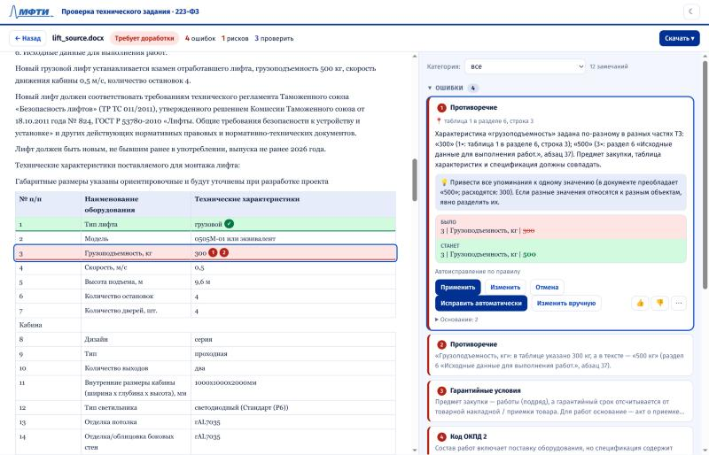
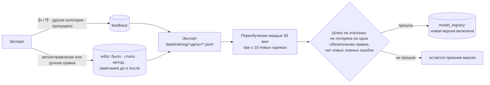
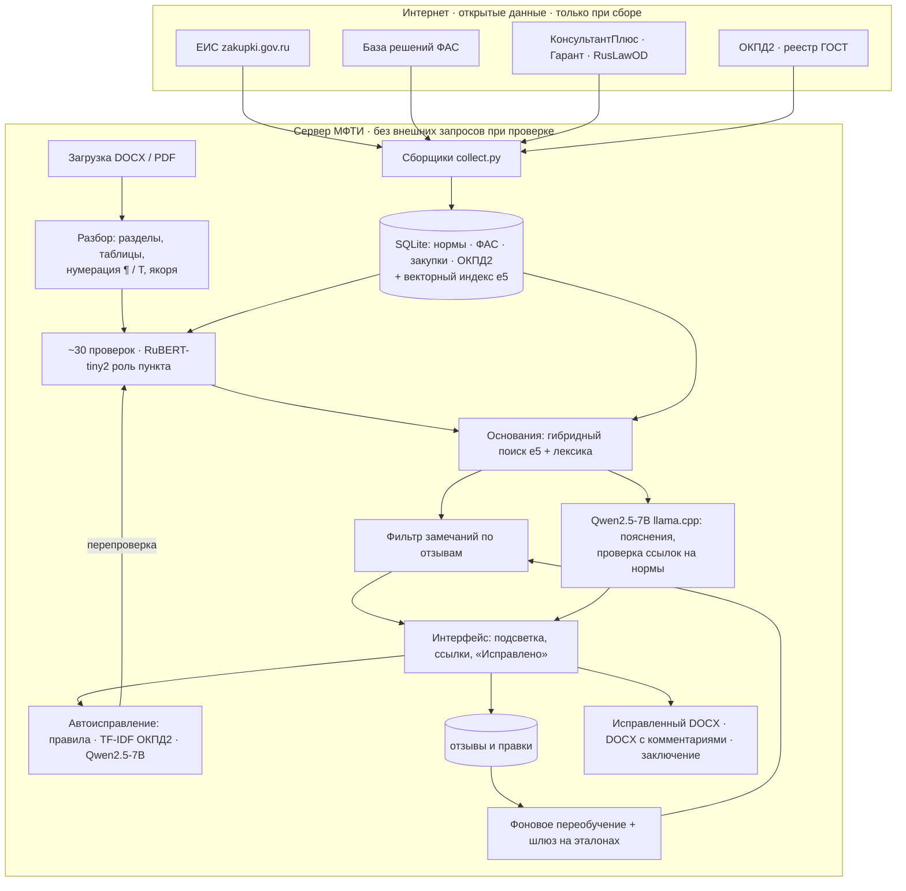

# Проверка ТЗ · 223-ФЗ

**Интеллектуальная проверка технического задания на закупку товаров, работ и услуг по 223-ФЗ.**
Хакатон МФТИ, задача 1.

Система находит в техническом задании ошибки, спорные требования и риски, показывает каждую проблему прямо в
тексте документа, объясняет её со ссылкой на норму, предлагает исправление и сама проверяет, что исправление
снимает замечание. Работает локально: документы никуда не отправляются.

> *English summary.* A self-contained reviewer for Russian public-procurement technical specifications (223-FZ).
> It parses DOCX/PDF into sections, attribute tables and item lists, runs about 30 kinds of deterministic checks backed by an
> internal knowledge base (laws, 420 FAS rulings, the ОКПД2 classifier, a standards registry), anchors every finding
> to the exact fragment, proposes verified fixes, and learns from reviewer feedback behind a regression gate.
> No external API calls at review time.

**Демо:** https://185-17-3-218.sslip.io — кнопка «Войти в демо-режиме», затем любой пример документа.



---

## Главное

> **Полностью локально, на сервере МФТИ. Никаких сторонних LLM и облачных API.** Документ заказчика не покидает
> сервер: разбор, проверки, поиск оснований, автоисправление, пояснения LLM и дообучение выполняются на своей машине
> с открытыми весами моделей.

| Чем это отличается от «вставить ТЗ в ChatGPT» | Обычный путь | Эта система |
|---|---|---|
| Где обрабатывается документ | чужое облако, данные заказчика уходят третьей стороне | сервер МФТИ, ни одного внешнего запроса при проверке |
| Откуда берутся нормы | «по памяти» модели, ссылки бывают выдуманы | собственная база: 223-ФЗ и 44-ФЗ по частям, 76 изменяющих законов, 420 доводов ФАС; LLM-ответ отбрасывается, если ссылается на норму не из базы |
| Где именно ошибка | пересказ своими словами | каждое замечание привязано к пронумерованному фрагменту (¶12, Т1.3); клик прокручивает к нему |
| Исправление | новый текст, который нужно сверять вручную | «было / станет» с подтверждением; после правки документ перепроверяется целиком, история правок видна как diff в GitHub |
| Повторяемость | разные ответы на один и тот же файл | детерминированные проверки; метрики на эталонах: 27/27, 0 ложных ошибок |
| Обучение | модель не знает, что вы её поправили | оценки и правки сохраняются и дообучают фильтр; новая модель включается только если не хуже на эталонах |
| Код ОКПД2 | угадывается | подбирается по всем 21 081 коду классификатора |

**Ключевые идеи**

1. **Знания, а не память модели.** Открытые данные из интернета (ЕИС, база решений ФАС, тексты законов, классификатор
   ОКПД2, реестр стандартов) собраны своими сборщиками в одну базу SQLite и индекс. Каждое замечание опирается на запись в этой базе.
2. **Правила впереди, LLM позади.** Около 30 детерминированных проверок дают воспроизводимый результат за 1–3 с.
   Локальная LLM (Qwen2.5-7B, 4 бит, llama.cpp) только поясняет и предлагает правку там, где правила бессильны; её ответ проверяется на выдуманные нормы и числа.
3. **Проверяемость.** Документ пронумерован (¶ — абзацы, Т — таблицы и строки), ссылки в замечаниях кликабельны, все правки видны в разделе «Исправлено».
4. **Учится на экспертах, но безопасно.** Каждая оценка 👍/👎, смена категории, пропущенная проблема и правка документа
   сохраняются; фон раз в 30 минут переобучает модель и включает её только после прохождения эталонного «шлюза».

## Как сохраняются правки и как идёт дообучение



| Таблица | Что хранит |
|---|---|
| `reviews`, `review_findings` | каждый проверенный документ и все замечания с якорями и основаниями |
| `feedback` | вердикт эксперта по замечанию, исправленная категория, комментарий, пропущенные проблемы с фрагментом |
| `edits` | исходный и новый текст фрагмента, метод (правило / ОКПД-модель / LLM / вручную), замечания до и после — готовые пары «ошибка → исправление» для дообучения |
| `model_registry` | версии моделей, метрики на эталонах, какая включена |

Тестовые и синтетические записи (`source='test'`, служебные пользователи) в обучение не попадают. Подробно: [docs/training_loop.md](docs/training_loop.md).

## Открытые данные, собранные системой

Все источники публичные; сборщики (`collect.py`, `procdata/collectors/`) складывают их в `data/procurement.sqlite`.

| Источник | Что взято | Зачем |
|---|---|---|
| ЕИС zakupki.gov.ru | 321 закупка по 223-ФЗ, 2 778 вложений, 46 752 пункта ТЗ | как пишут реальные ТЗ; реестр упоминаемых стандартов; обучение классификатора ролей пунктов |
| База решений ФАС | 437 дел, 692 документа, 420 доводов жалоб | какие требования оспаривают и как ФАС решает — прецеденты в каждом замечании |
| КонсультантПлюс, Гарант, RusLawOD | 223-ФЗ и 44-ФЗ по статьям и частям (1 623 нормы), 76 изменяющих законов | точные ссылки на норму с актуальной редакцией |
| ОК 034-2014 (ОКПД2) | 21 081 код | проверка и подбор кода по наименованию |
| Реестр стандартов | ГОСТ / ГОСТ Р, обозначения и статусы | проверка обозначений и действующих стандартов |

## Что умеет

| | |
|---|---|
| **Читает документ** | DOCX, DOC, RTF, ODT, PDF, XLSX. Разделы, таблицы характеристик, спецификации с ОКПД2, ключевые поля (предмет, вид договора, гарантия, стандарты). Повреждённые файлы отклоняются с понятной причиной |
| **Находит проблемы 9 категорий** | противоречия между частями ТЗ · некорректные характеристики (нет единиц, оценочные слова) · комплектность · код ОКПД 2 · гарантийные условия · стандарты (ГОСТ / ГОСТ Р) · ограничение конкуренции (марка без «или эквивалент», запрет эквивалента, квалификация) · положения, которым не место в ТЗ · оформление |
| **Показывает в документе** | документ пронумерован (¶ абзацы, Т таблицы и строки); каждая проблема подсвечена, ссылки в замечаниях прокручивают к фрагменту |
| **История правок** | раздел «Исправлено»: что было и что стало, как в GitHub (−/+), кто и каким способом исправил, снято ли замечание |
| **Объясняет и обосновывает** | статья и часть 223-ФЗ, решения ФАС по похожим требованиям, классификатор ОКПД2; если данных не хватает — честно «требует проверки» |
| **Исправляет** | «Исправить автоматически» показывает «было / станет», после подтверждения правка применяется и документ перепроверяется целиком |
| **Выдаёт результат** | исправленный DOCX · DOCX с подсветкой и комментариями Word · заключение (DOCX / PDF) · JSON |
| **Учится** | оценки 👍/👎, «другая категория», пропущенные проблемы и правки сохраняются; модель-фильтр переобучается в фоне и включается, только если не ухудшает эталонный результат |

## Качество

Измерено на документах организаторов (исходное ТЗ → ТЗ, исправленное экспертом) и двух собственных ТЗ из других
предметных областей (`python eval_case.py`, `python eval_autofix.py`).

| Метрика | Результат |
|---|---|
| Обязательные правки эксперта найдены | **27 / 27** (лифт 6/6, метрология 4/4, клининг 9/9, вычислительная техника 8/8) |
| Необязательные правки найдены | **7 / 7** |
| Ложные ошибки на исправленных версиях | **0** |
| Автоисправление: предложено / сняло замечание / создало новую проблему | **32 / 32 / 0** из 47 замечаний |
| Код ОКПД2, подобранный по наименованию, совпал с выбором эксперта | плита поверочная 26.51.33.142, измеритель момента 26.51.66.113 |
| Время проверки документа (без LLM) | 1–3 с |

## Быстрый старт: полный экземпляр на своей машине

Требуется: Linux / macOS / WSL2, Docker, Python 3.10+ (только для `setup.sh`), ~8 ГБ на диске.
Для локальной LLM — ≥ 10 ГБ RAM; без неё хватит 2 ГБ.

```bash
git clone https://github.com/XxSNiPxX/tz-review-223fz.git && cd tz-review-223fz
./setup.sh                      # база знаний + модели (~5,5 ГБ); ./setup.sh --no-llm — без LLM (~0,6 ГБ)
docker compose up --build -d    # http://localhost:8000
```

`setup.sh` скачивает:

| Что | Откуда | Размер | Куда |
|---|---|---|---|
| База знаний: нормы 223-ФЗ/44-ФЗ, решения ФАС, закупки ЕИС, ОКПД2, поисковый индекс, примеры и эталоны (без пользовательских данных) | [релиз v1.0](https://github.com/XxSNiPxX/tz-review-223fz/releases/tag/v1.0) `tz-review-kb.tar.gz` | 31 МБ | `data/` |
| Дообученный RuBERT-tiny2 (роль пункта), базовые классификаторы | релиз v1.0 `tz-review-models.tar.gz` | 104 МБ | `models/` |
| multilingual-e5-small (эмбеддинги) | Hugging Face `intfloat/multilingual-e5-small` | 470 МБ | `models/multilingual-e5-small/` |
| Qwen2.5-7B-Instruct Q4_K_M (LLM) | Hugging Face `bartowski/Qwen2.5-7B-Instruct-GGUF` | 4,7 ГБ | `models/` |

Контрольные суммы архивов проверяются. После установки сеть не нужна: проверка документов не делает внешних запросов.
Первая сборка Docker-образа занимает 5–15 минут (компиляция llama.cpp).

Слабая машина (< 4 ГБ RAM) — облегчённый образ без PyTorch и LLM, качество на эталонах то же:

```bash
./setup.sh --no-llm
docker build --build-arg LITE=1 --build-arg WITH_LLM=0 -t tz-review:latest . && docker compose up -d
```

Без Docker:

```bash
python3 -m venv .venv && . .venv/bin/activate
pip install -r requirements.txt scikit-learn joblib sentence-transformers llama-cpp-python
./setup.sh
uvicorn server:app --port 8000
python review.py data/case/lift_source.docx --no-llm     # проверка из командной строки
python eval_case.py                                       # воспроизвести метрики на эталонах
```

Публичный сервер с HTTPS и входом (VPS):

```bash
ssh-copy-id root@HOST && ./deploy/deploy.sh root@HOST    # серверы < 2 ГБ RAM получают облегчённый режим автоматически
```

Остановка: `docker compose down`. Пересобрать базу знаний с нуля из открытых источников (необязательно, часы):
см. [docs/collectors_and_internals.md](docs/collectors_and_internals.md) (`python collect.py …`). Дообучить классификатор
роли пункта: `python collect.py finetune` (база `cointegrated/rubert-tiny2` скачивается в `models/rubert-tiny2/`).

### Переменные окружения

| Переменная | По умолчанию | Назначение |
|---|---|---|
| `REVIEW_USE_LLM` | `1` | пояснения локальной LLM, если файл модели есть в `models/` |
| `REVIEW_LITE` | `0` | `1` — без PyTorch (правила + база знаний), для серверов < 2 ГБ RAM; качество на эталонах то же |
| `AUTH_DEMO` | `0` | `1` — кнопка «Войти в демо-режиме» |
| `AUTH_YANDEX_CLIENT_ID/SECRET`, `AUTH_GOOGLE_CLIENT_ID/SECRET` | — | вход через Яндекс ID и Google (OAuth 2.0) |
| `AUTH_ALLOWED_DOMAINS`, `AUTH_ALLOWED_EMAILS` | — | ограничение доступа, например `phystech.edu` |
| `SESSION_SECRET` | генерируется при развёртывании | подпись cookie сессии |
| `REVIEW_AUTO_RETRAIN` | `1` | фоновое переобучение фильтра по отзывам |

Внешние сервисы во время проверки: **нет**. Сеть нужна только сборщикам базы знаний и для входа через Яндекс/Google.

## Архитектура



| Слой | Где | Что делает |
|---|---|---|
| Разбор | `procdata/ingest.py` | структура DOCX/PDF, якоря «таблица 1, строка 3» |
| Проверки | `procdata/checks.py`, `procdata/checks_doc.py` | пункты и документ целиком; словарь характеристик `kb/attribute_units.json` различает величины, счётные и безразмерные параметры |
| База знаний | `data/procurement.sqlite`, `kb/` | нормы, ФАС, ОКПД2, реестр стандартов, словари |
| Поиск оснований | `procdata/index.py` | multilingual-e5-small + лексическое совпадение |
| Автоисправление | `procdata/autofix.py` | переписывание по правилам, подбор ОКПД2 (TF-IDF по классификатору), LLM как запасной путь; каждое исправление проверяется |
| Модели | `procdata/finetune.py`, `procdata/explain.py`, `procdata/training.py` | RuBERT-tiny2 (роль пункта), Qwen2.5-7B (пояснения), фильтр замечаний по отзывам |
| Сервер и интерфейс | `server.py`, `web/` | FastAPI, вход, загрузка, редактирование, отчёты |

Подробности: [docs/architecture.md](docs/architecture.md) · [обучение на отзывах](docs/training_loop.md) ·
[сборщики базы знаний и внутреннее устройство](docs/collectors_and_internals.md) · [точность разбора](docs/extraction_check.md).

### Модели

| Модель | Параметры | Роль | Где работает |
|---|---|---|---|
| Правила + база знаний | — | находят проблемы, дают основания | везде |
| TF-IDF по ОКПД2 | — | подбирает код по наименованию позиции | везде |
| multilingual-e5-small | 118 M | поиск похожих норм и решений ФАС | полный режим |
| RuBERT-tiny2, дообучен | 29 M | роль пункта: техническое требование / условия договора / ссылки на право | полный режим |
| Qwen2.5-7B-Instruct, 4 бит | 7,6 B | пояснения и правки там, где правила бессильны; ответ проверяется на выдуманные нормы и числа | полный режим, ≥ 10 ГБ RAM |
| Фильтр замечаний (логистическая регрессия) | — | учится, какие замечания эксперты отклоняют; включается только после проверки на эталонах | везде |

Эталон для оценки: 2 пары ТЗ «исходное / итоговое» от организаторов + 2 собственных ТЗ (`kb/gold/case_gold.json`).

## API

| Метод | Путь | |
|---|---|---|
| `POST` | `/api/reviews` | загрузить файл (multipart `file`) |
| `GET` | `/api/reviews/{id}` | статус и отчёт |
| `POST` | `/api/reviews/{id}/suggest` | автоисправление замечания |
| `POST` | `/api/reviews/{id}/edits` | применить правку и перепроверить |
| `POST` | `/api/reviews/{id}/feedback` | оценка, комментарий, пропущенная проблема |
| `GET` | `/api/reviews/{id}/edited.docx`, `annotated.docx`, `report.docx`, `report.html` | результаты |

## Примеры

**Работы: замена грузового лифта** (`data/case/lift_source.docx`). Тип лифта «пассажирский» в таблице против «грузовой»
в предмете закупки; грузоподъёмность 300 против 500 кг; гарантия на работы от товарной накладной вместо КС-2/КС-3;
«ГОСТ 53782-2010» без «Р»; поставка лифта без отдельной позиции с кодом товара. Все пять — ошибки с автоисправлением.

**Поставка: метрологическое оборудование** (`data/case/metrology_source.docx`). Комплекты без состава, общие коды
«…190», фраза о национальном режиме в ТЗ. Коды уточняются автоматически по наименованию позиции.

## Ограничения

- Положения о закупке конкретных заказчиков и перечень СМП (ПП 1352) пока не в базе: такие проверки помечаются «требует проверки».
- Рыночные данные (каталоги товаров) не собраны: избыточность характеристик оценивается по признакам, а не по рынку.
- LLM на CPU медленная (около минуты на пояснение); на сервере с 709 МБ RAM работает облегчённый режим без неё.

## Структура репозитория

```
server.py            HTTP-сервер и API          review.py      проверка из командной строки
procdata/            разбор, проверки, модели   web/           интерфейс
kb/                  словари, эталоны, ОКПД2    deploy/        VPS: Docker Compose, Caddy, скрипт
docs/                документация, слайды       eval_case.py   оценка на эталонах
collect.py           сборщики базы знаний       eval_autofix.py оценка автоисправления
```

Лицензия кода: MIT. Тексты законов — общественное достояние; данные RusLawOD — CC BY-NC; логотип МФТИ принадлежит МФТИ
и используется только в демо хакатона.
