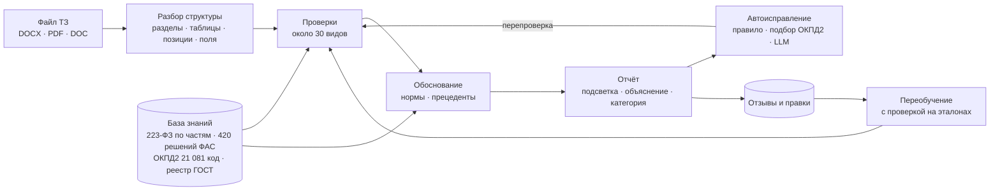

# Проверка ТЗ · 223-ФЗ

**Интеллектуальная проверка технического задания на закупку товаров, работ и услуг по 223-ФЗ.**
Хакатон МФТИ, задача 1.

Система находит в техническом задании ошибки, спорные требования и риски, показывает каждую проблему прямо в
тексте документа, объясняет её со ссылкой на норму, предлагает исправление и сама проверяет, что исправление
снимает замечание. Работает локально: документы никуда не отправляются.

> *English summary.* A self-contained reviewer for Russian public-procurement technical specifications (223-FZ).
> It parses DOCX/PDF into sections, attribute tables and item lists, runs about 30 kinds of deterministic checks backed by an
> internal knowledge base (laws, 420 FAS rulings, the ОКПД2 classifier, a standards registry), anchors every finding
> to the exact fragment, proposes verified fixes, and learns from reviewer feedback behind a regression gate.
> No external API calls at review time.

**Демо:** https://185-17-3-218.sslip.io — кнопка «Войти в демо-режиме», затем любой пример документа.


---

## Что умеет

| | |
|---|---|
| **Читает документ** | DOCX, DOC, RTF, ODT, PDF, XLSX. Разделы, таблицы характеристик, спецификации с ОКПД2, ключевые поля (предмет, вид договора, гарантия, стандарты). Повреждённые файлы отклоняются с понятной причиной |
| **Находит проблемы 9 категорий** | противоречия между частями ТЗ · некорректные характеристики (нет единиц, оценочные слова) · комплектность · код ОКПД 2 · гарантийные условия · стандарты (ГОСТ / ГОСТ Р) · ограничение конкуренции (марка без «или эквивалент», запрет эквивалента, квалификация) · положения, которым не место в ТЗ · оформление |
| **Показывает в документе** | каждая проблема подсвечена в тексте или строке таблицы, с номером; клик по подсветке открывает замечание |
| **Объясняет и обосновывает** | статья и часть 223-ФЗ, решения ФАС по похожим требованиям, классификатор ОКПД2; если данных не хватает — честно «требует проверки» |
| **Исправляет** | «Исправить автоматически» показывает «было / станет», после подтверждения правка применяется и документ перепроверяется целиком |
| **Выдаёт результат** | исправленный DOCX · DOCX с подсветкой и комментариями Word · заключение (DOCX / PDF) · JSON |
| **Учится** | оценки 👍/👎, «другая категория», пропущенные проблемы и правки сохраняются; модель-фильтр переобучается в фоне и включается, только если не ухудшает эталонный результат |

## Качество

Измерено на документах организаторов (исходное ТЗ → ТЗ, исправленное экспертом) и двух собственных ТЗ из других
предметных областей (`python eval_case.py`, `python eval_autofix.py`).

| Метрика | Результат |
|---|---|
| Обязательные правки эксперта найдены | **27 / 27** (лифт 6/6, метрология 4/4, клининг 9/9, вычислительная техника 8/8) |
| Необязательные правки найдены | **7 / 7** |
| Ложные ошибки на исправленных версиях | **0** |
| Автоисправление: предложено / сняло замечание / создало новую проблему | **32 / 32 / 0** из 47 замечаний |
| Код ОКПД2, подобранный по наименованию, совпал с выбором эксперта | плита поверочная 26.51.33.142, измеритель момента 26.51.66.113 |
| Время проверки документа (без LLM) | 1–3 с |

## Быстрый старт

```bash
git clone <repo> tz-review && cd tz-review
tar xzf kb_release_YYYYMMDD.tar.gz          # база знаний: data/procurement.sqlite, data/index/, kb/
docker compose up --build -d                # http://localhost:8000
```

Без Docker:

```bash
python3 -m venv .venv && . .venv/bin/activate && pip install -r requirements.txt
uvicorn server:app --port 8000
python review.py data/case/lift_source.docx --no-llm     # проверка из командной строки
```

Публичный сервер (VPS, HTTPS, вход):

```bash
ssh-copy-id root@HOST && ./deploy/deploy.sh root@HOST    # серверы < 2 ГБ RAM получают облегчённый режим автоматически
```

Остановка: `docker compose down`.

### Переменные окружения

| Переменная | По умолчанию | Назначение |
|---|---|---|
| `REVIEW_USE_LLM` | `1` | пояснения локальной LLM, если файл модели есть в `models/` |
| `REVIEW_LITE` | `0` | `1` — без PyTorch (правила + база знаний), для серверов < 2 ГБ RAM; качество на эталонах то же |
| `AUTH_DEMO` | `0` | `1` — кнопка «Войти в демо-режиме» |
| `AUTH_YANDEX_CLIENT_ID/SECRET`, `AUTH_GOOGLE_CLIENT_ID/SECRET` | — | вход через Яндекс ID и Google (OAuth 2.0) |
| `AUTH_ALLOWED_DOMAINS`, `AUTH_ALLOWED_EMAILS` | — | ограничение доступа, например `phystech.edu` |
| `SESSION_SECRET` | генерируется при развёртывании | подпись cookie сессии |
| `REVIEW_AUTO_RETRAIN` | `1` | фоновое переобучение фильтра по отзывам |

Внешние сервисы во время проверки: **нет**. Сеть нужна только сборщикам базы знаний и для входа через Яндекс/Google.

## Архитектура



| Слой | Где | Что делает |
|---|---|---|
| Разбор | `procdata/ingest.py` | структура DOCX/PDF, якоря «таблица 1, строка 3» |
| Проверки | `procdata/checks.py`, `procdata/checks_doc.py` | пункты и документ целиком; словарь характеристик `kb/attribute_units.json` различает величины, счётные и безразмерные параметры |
| База знаний | `data/procurement.sqlite`, `kb/` | нормы, ФАС, ОКПД2, реестр стандартов, словари |
| Поиск оснований | `procdata/index.py` | multilingual-e5-small + лексическое совпадение |
| Автоисправление | `procdata/autofix.py` | переписывание по правилам, подбор ОКПД2 (TF-IDF по классификатору), LLM как запасной путь; каждое исправление проверяется |
| Модели | `procdata/finetune.py`, `procdata/explain.py`, `procdata/training.py` | RuBERT-tiny2 (роль пункта), Qwen2.5-7B (пояснения), фильтр замечаний по отзывам |
| Сервер и интерфейс | `server.py`, `web/` | FastAPI, вход, загрузка, редактирование, отчёты |

Подробности: [docs/architecture.md](docs/architecture.md) · [обучение на отзывах](docs/training_loop.md) ·
[сборщики базы знаний и внутреннее устройство](docs/collectors_and_internals.md) · [точность разбора](docs/extraction_check.md).

### Модели

| Модель | Параметры | Роль | Где работает |
|---|---|---|---|
| Правила + база знаний | — | находят проблемы, дают основания | везде |
| TF-IDF по ОКПД2 | — | подбирает код по наименованию позиции | везде |
| multilingual-e5-small | 118 M | поиск похожих норм и решений ФАС | полный режим |
| RuBERT-tiny2, дообучен | 29 M | роль пункта: техническое требование / условия договора / ссылки на право | полный режим |
| Qwen2.5-7B-Instruct, 4 бит | 7,6 B | пояснения и правки там, где правила бессильны; ответ проверяется на выдуманные нормы и числа | полный режим, ≥ 10 ГБ RAM |
| Фильтр замечаний (логистическая регрессия) | — | учится, какие замечания эксперты отклоняют; включается только после проверки на эталонах | везде |

## Данные

| Источник | Объём | Для чего |
|---|---|---|
| ЕИС, zakupki.gov.ru | 321 закупка, 2 778 вложений, 46 752 пункта ТЗ | разнообразие реальных ТЗ, реестр стандартов |
| База решений ФАС | 437 дел, 692 документа, 420 доводов | что оспаривают и как решает ФАС |
| КонсультантПлюс, Гарант, RusLawOD | 223-ФЗ и 44-ФЗ: 1 623 нормы, 76 изменяющих законов | основания |
| prog815/okpd2 | 21 081 код ОК 034-2014 | проверка и подбор кодов |
| Организаторы | 2 пары ТЗ «исходное / итоговое» | эталон для оценки |

## API

| Метод | Путь | |
|---|---|---|
| `POST` | `/api/reviews` | загрузить файл (multipart `file`) |
| `GET` | `/api/reviews/{id}` | статус и отчёт |
| `POST` | `/api/reviews/{id}/suggest` | автоисправление замечания |
| `POST` | `/api/reviews/{id}/edits` | применить правку и перепроверить |
| `POST` | `/api/reviews/{id}/feedback` | оценка, комментарий, пропущенная проблема |
| `GET` | `/api/reviews/{id}/edited.docx`, `annotated.docx`, `report.docx`, `report.html` | результаты |

## Примеры

**Работы: замена грузового лифта** (`data/case/lift_source.docx`). Тип лифта «пассажирский» в таблице против «грузовой»
в предмете закупки; грузоподъёмность 300 против 500 кг; гарантия на работы от товарной накладной вместо КС-2/КС-3;
«ГОСТ 53782-2010» без «Р»; поставка лифта без отдельной позиции с кодом товара. Все пять — ошибки с автоисправлением.

**Поставка: метрологическое оборудование** (`data/case/metrology_source.docx`). Комплекты без состава, общие коды
«…190», фраза о национальном режиме в ТЗ. Коды уточняются автоматически по наименованию позиции.

## Ограничения

- Положения о закупке конкретных заказчиков и перечень СМП (ПП 1352) пока не в базе: такие проверки помечаются «требует проверки».
- Рыночные данные (каталоги товаров) не собраны: избыточность характеристик оценивается по признакам, а не по рынку.
- LLM на CPU медленная (около минуты на пояснение); на сервере с 709 МБ RAM работает облегчённый режим без неё.

## Структура репозитория

```
server.py            HTTP-сервер и API          review.py      проверка из командной строки
procdata/            разбор, проверки, модели   web/           интерфейс
kb/                  словари, эталоны, ОКПД2    deploy/        VPS: Docker Compose, Caddy, скрипт
docs/                документация, слайды       eval_case.py   оценка на эталонах
collect.py           сборщики базы знаний       eval_autofix.py оценка автоисправления
```

Лицензия кода: MIT. Тексты законов — общественное достояние; данные RusLawOD — CC BY-NC; логотип МФТИ принадлежит МФТИ
и используется только в демо хакатона.
